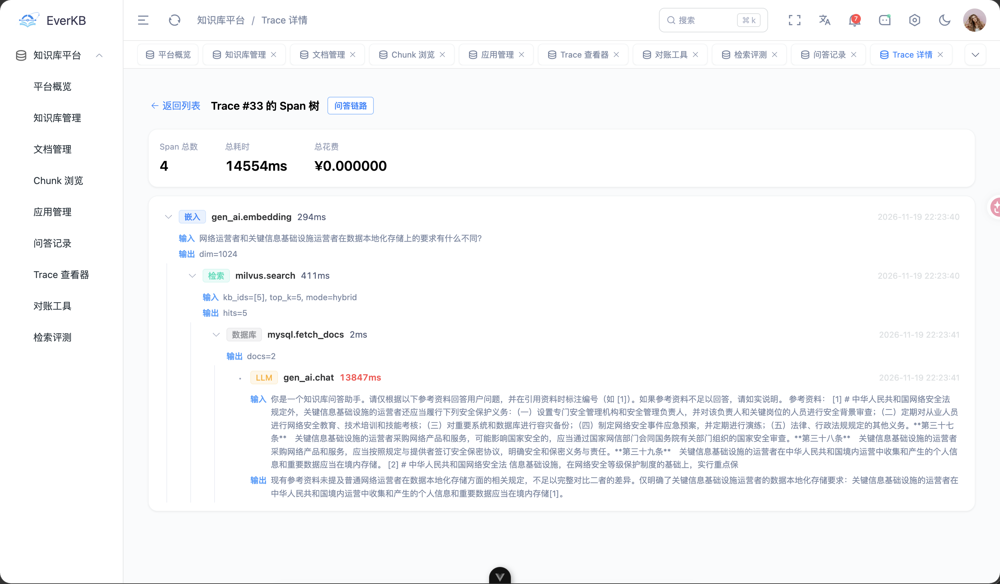
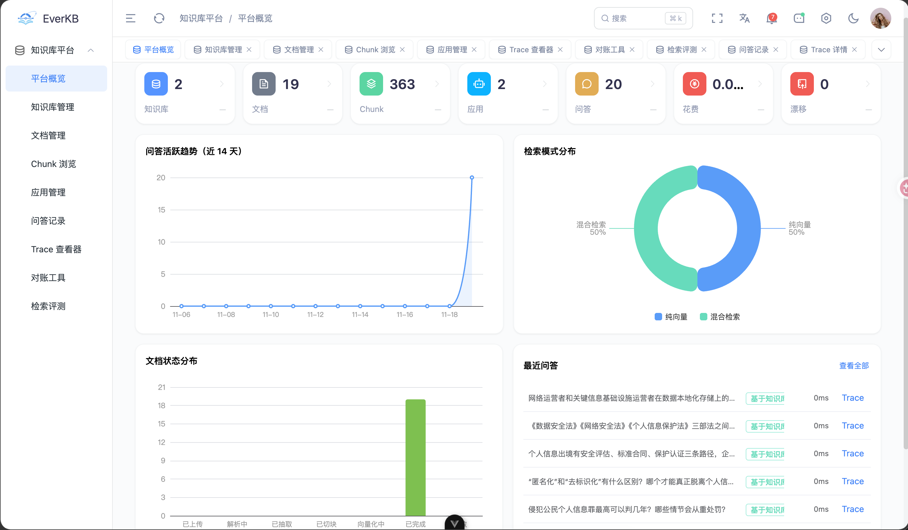
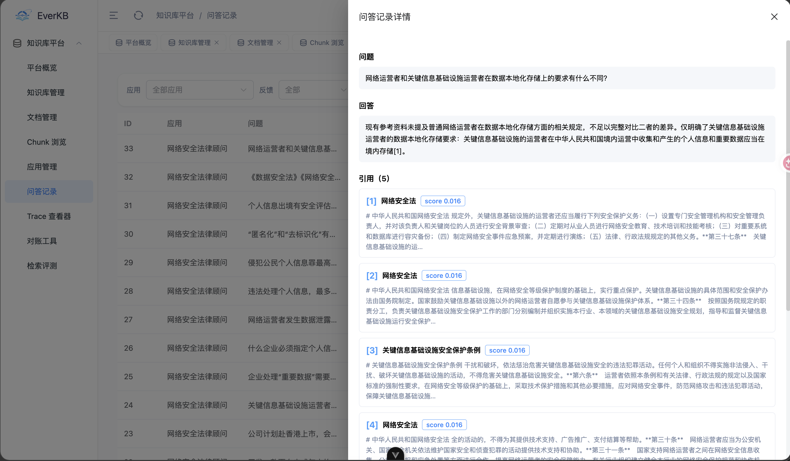
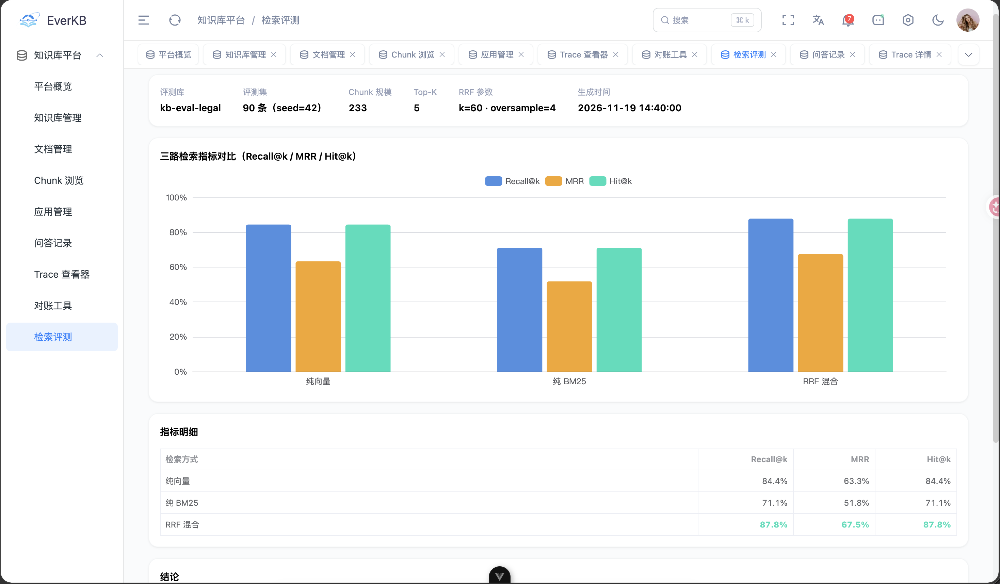

# EverKB · 可观测的 RAG 知识库平台

> 一个为「长期运营」而设计的 RAG 知识库管理平台。
> 不只是把文档丢进去就能聊——而是让知识库**不会腐烂**、让回答**可以定位**、让链路**看得见**。

[](LICENSE)
[](https://www.python.org/)
[](https://fastapi.tiangolo.com/)
[](https://vuejs.org/)
[](https://milvus.io/)

---

## 为什么是 EverKB？

市面上的开源 RAG 平台（Dify、RAGFlow、MaxKB、FastGPT、AnythingLLM）都瞄准了**接入期**——传文档、建机器人、聊起来。它们做得很好，但你一旦用上三个月，就会撞上三个没人解决的问题：

| 问题 | 现有平台的答案 | EverKB 的答案 |
|---|---|---|
| **知识库会腐烂**：文档更新了、删了、停用了，但旧向量还在被检索命中 | 「你手动删掉重新传」 | **文档生命周期状态机** + 替换重传 + 启停 + 失败重试，自动重新切块/向量化 |
| **回答变差无法定位**：这次回答为什么漏了关键信息？检索命中了什么？ | 「看日志吧」 | **原生内置 Trace/Span 观测**，每次问答的 embedding→检索→LLM 每一步耗时/命中/花费都在界面上 |
| **存储不一致没底**：MySQL 里的 chunk 和 Milvus 里的向量对不上 | 「祈祷」 | **内置对账工具**，一键扫描漂移文档 |

> **一句话：别人帮你「接入」知识库，EverKB 帮你「养」知识库。**

## 核心特性

- 📄 **多格式文档管线**：Word / PDF / Excel / TXT / Markdown / CSV / HTML + 网页链接，统一解析为 Markdown → 切块 → 向量化，状态机驱动、失败可重试
- ✏️ **Markdown 即内容真相**：解析产物可在后台在线编辑，保存后自动重新切块 + 向量化（跳过重复解析）
- 🔍 **检索问答 + 引用溯源**：按应用挂载多个知识库，SSE 流式返回回答 + 引用卡片（doc / chunk / 页码 / 分数 / 原文链接）
- 📈 **平台概况驾驶舱**：首页 KPI 卡片（知识库/文档/Chunk/应用/问答/花费）+ 近 14 天问答趋势 + 检索模式分布 + 文档状态分布 + 异常告警，卡片可点击下钻
- 📊 **原生全链路可观测**：每次问答自动埋点 Span 成链，后台 Trace 查看器展示 Span 树 + 聚合分析（最慢调用 Top N、各阶段 P95 耗时）
- 🔀 **BM25 混合检索**：向量语义 + 关键词（jieba 分词 + 手写 BM25）双路检索，RRF 倒数排名融合，法条/专有名词检索更准
- 🧪 **检索评测与消融实验**：合成评测集 + Recall@k / MRR / Hit@k 指标，一键跑「纯向量 vs 纯 BM25 vs 混合」对比报告
- 🧹 **对账工具**：扫描「已完成」文档的漂移（chunk 未向量化 / MySQL 与 Milvus 数量不一致）
- 🔌 **可插拔模型**：LLM 与 Embedding 全走 OpenAI 兼容协议，豆包 / 通义 / DeepSeek / Ollama 均可即插即用（改 `.env` 即切换，无需动代码）
- 🗄️ **可插拔存储**：本地磁盘（默认，开箱即跑）/ 阿里云 OSS
- 🔐 **应用级 API Key**：每个问答应用独立 key，创建 / 重置时一次性展示明文，其余脱敏
- 🏢 **商业化多租户**：平台管理员 / 企业管理员两级账号，一人一企业、数据全隔离；运营工作台开通企业 + 发注册码，体验者凭码自助注册
- 💰 **企业钱包计费**：企业级 token 额度全员共享，问答按真实 usage 计费，流水可追溯；open 侧 API Key 调用同样计入所属企业钱包
- ❄️ **企业生命周期**：试用 → 正式 → 只读冻结 → 清理的状态机，到期只读冻结 60 天后清理，充值/转正即恢复

## 界面预览

| Trace 查看器（Span 树 · 时间轴 · 耗时下钻） | 平台驾驶舱（KPI · 14 天趋势 · 分布） |
| :---: | :---: |
|  |  |

| 流式问答 + 引用溯源（用户端） | 检索评测三路消融对比 |
| :---: | :---: |
|  |  |

## 检索评测

EverKB 不只「有」检索能力，还用一套可复现的评测工程**量化**了它。基于 12 部「网络安全与数据合规」法规（233 chunk）构建合成评测集（90 条，seed=42），对三种检索方式做消融实验：

| 检索方式 | Recall@5 | MRR | Hit@5 |
|---|---|---|---|
| 纯向量（Milvus COSINE） | 84.4% | 0.633 | 84.4% |
| 纯 BM25（jieba 分词） | 71.1% | 0.518 | 71.1% |
| **RRF 混合** | **87.8%** | **0.675** | **87.8%** |

**结论**：混合检索在召回与排序上均优于任意单路——向量补足语义改写，BM25 补足专有名词/法条精确命中，RRF 倒数排名融合让两者互补而非冲突。

> 管理后台「检索评测」页可直接查看三路指标对比图（数据源 `data/legal/ablation_result.json`，由 `run_ablation.py` 自动生成），无需读文档。

```bash
python scripts/fetch_legal_corpus.py   # 抓取 12 部法规 → data/legal/
python scripts/seed_eval_kb.py         # 建评测库 kb-eval-legal 并入库（233 chunk）
python scripts/build_eval_set.py       # 真实 LLM 合成评测集（90 条）
python scripts/run_ablation.py         # 三路消融跑分 → 生成评测报告 + ablation_result.json
```

## 架构

```
┌─────────────────────────────────────────────────┐
│                 单机 Docker Compose              │
│                                                 │
│  ┌──────────┐   ┌──────────┐   ┌──────────┐   │
│  │ FastAPI  │──▶│  MySQL   │   │  Milvus  │   │
│  │  后端     │   │ (元数据)  │   │ (向量)   │   │
│  │  Worker  │   └──────────┘   └──────────┘   │
│  └────┬─────┘        ▲              ▲          │
│       │              │              │          │
│  ┌────▼─────┐   ┌────┴──────┐  ┌────┴──────┐   │
│  │ Vue 管理 │   │ 文档/Chunk │  │ 向量索引   │   │
│  │ 后台     │   │ 双写一致性  │  │ 对账扫描   │   │
│  └──────────┘   └───────────┘  └───────────┘   │
│                                                 │
│  存储(可插拔)          LLM/Embedding(可插拔)      │
│  本地磁盘 / OSS        豆包 / 通义 / DeepSeek      │
│                        / Ollama (OpenAI兼容)     │
└─────────────────────────────────────────────────┘
```

**问答链路（每次问答自动埋点成 Trace）**

```
问题 → [embedding] → [retrieval 检索] → [db 文档确认] → [llm 流式生成] → 回答 + 引用
         └─────┴──────┴──────┴─────── 全部 Span 成链，落库可回看 ──────┘
```

**入库链路（文档解析管线同样纳入观测）**

```
文档上传 → [parse 解析] → [chunking 切块] → [embedding 嵌入] → [vector_insert 向量入库]
               └─────┴──────┴──────┴─────── 管线 Span 成链，Trace 查看器「入库链路」tab 可看 ──────┘
```

## 多租户与商业化

EverKB 是**试用即产品**的多租户平台：企业开通试用得到的就是完整商业产品 + 额度帽，体验路径即转化漏斗。v1 固定两级角色，一人一企业，数据全程租户隔离。

### 角色与两个工作台

| 角色 | 常量 | 进入 | 能做什么 |
|---|---|---|---|
| 平台管理员 | `platform` | 运营工作台 | 开通/充值/转正/冻结企业与钱包、平台级统计；不干预企业内部数据 |
| 企业管理员 | `ent_admin` | 企业控制台 | 本企业一切：知识库/文档/应用增删改、问答、看本企业记录与 Trace、看钱包消耗 |
| 企业成员 | `member` | 企业控制台 | （v1 仅预留角色，账号开通能力后移）问答、看自己记录、浏览本企业知识库 |

> v1 只开通 `platform` 与 `ent_admin` 两种账号；`member` 角色在数据模型与鉴权依赖中已预留，成员账号体系作为下个版本第一项。

### 开通流程（体验 = 转化漏斗）

```
平台管理员 ──建企业 + 设额度/天数──▶ 生成企业管理员注册码 ──发码──▶ 体验者注册
                                                                        │
                                                          ┌─────────────┘
                                                          ▼
                                               ENT_ADMIN 落入企业控制台
                                             （本企业知识库 / 文档 / 应用 / 钱包）
```

1. 平台管理员在运营工作台（或脚本）建企业，设试用额度与天数；
2. 生成一次性企业管理员注册码（绑定 `enterprise_id`、限 `max_uses`）发给体验者；
3. 体验者凭码自助注册 → 即成为该企业的 `ent_admin`，进入真实企业控制台。

### 权限模型（两层授权，越权零信任）

- **角色层**：三级 fail-closed 鉴权依赖 —— `require_platform`（仅平台）/ `require_ent_admin`（企业管理动作）/ `require_enterprise`（企业侧公共基座，验企业状态）；
- **归属层**：所有租户资源查询/变更走统一入口 —— `scoped()` 自动带 `enterprise_id` 过滤列表、`ensure_owned()` 单对象不匹配即 404（不泄露存在性）。

每个「资源类型 × 角色」都配有一条越权锁定测试（`backend/tests/test_tenant_isolation.py`）。

### 企业生命周期

```
       充值/转正（人工）                          data_purge_at 到期
2 正式 ─────────────────┐            ┌─────────────────────────────┐
1 试用 ──trial 到期──▶ 3 只读冻结 ──▶ 4 已清理（业务数据删除，企业行保留）
                       ▲                │
                       └────── 60 天数据保留（充值/转正即恢复）────┘
```

到期 → **只读冻结**：可登录、浏览本企业数据（转化钩子），但问答/增删改一律 403，零成本；冻结 60 天后清理。到期前 7 天 worker 自动发通知提醒。

### 钱包计费

- 只有企业钱包，全员共享，无成员子额度；预算/已结算/在途预留三本账（`enterprise_wallet` + `wallet_transaction` 流水）；
- 双计费入口共用一套 reserve → 流式 → settle：企业控制台问答（`ent_admin`）与 open 侧 chat（`X-API-Key`）都扣所属企业钱包；平台账号（自己）问答不计费；
- 流式请求补 `stream_options.include_usage`，按厂商真实 token 结算，避免中文场景成本高估。

## 快速开始

### 前置依赖

- Docker + Docker Compose
- Python 3.11+
- Node.js 18+（前端）
- 一个 OpenAI 兼容的 LLM / Embedding 服务（豆包 / 通义 / DeepSeek / Ollama 均可）

> 🔧 **想用自己的模型？** 只需改 `.env` 里的 `ARK_*`（LLM）和 `EMBEDDING_*`（Embedding）几行——任何 OpenAI 兼容服务（DeepSeek / 通义 / Ollama / Kimi / GLM…）即插即用，无需改代码。

### 1. 启动中间件（MySQL + Milvus + Redis）

```bash
cp .env.example .env          # 填写你的密钥
docker compose up -d          # 启动 MySQL(3307) + Milvus(19530) + Redis(6379)
```

### 2. 启动后端

```bash
python3 -m venv .venv && source .venv/bin/activate
pip install -r requirements.txt
python3 scripts/seed_admin.py          # 创建首个平台管理员账号 + 默认企业
bash scripts/run_backend.sh            # 启动于 http://localhost:8000
```

### 3. 启动前端（管理后台 + 用户对话端）

```bash
cd admin && pnpm install && pnpm dev     # 管理后台
cd web   && pnpm install && pnpm dev     # 用户对话端
```

### 4. 体验完整链路

**平台侧（运营）**：登录运营工作台（`platform` 账号）→ 建企业 + 设额度/天数 → 生成企业管理员注册码。

**企业侧（体验者）**：凭注册码自助注册成为 `ent_admin` → 进入企业控制台：

1. 创建知识库 → 上传文档（等待状态机跑到「已完成」）
2. 创建「应用」→ 挂载知识库 → 复制 api_key
3. 打开用户对话端 → 填入 appId + apiKey → 发起问答
4. 看到 SSE 流式回答 + 引用卡片 → 回到管理后台看 **问答记录 + Trace 树 + 聚合分析**

> 一键冒烟验证：`python3 scripts/smoke_e2e_qa.py --password '你的admin密码'`
>
> 播种示例企业（预置示例知识库 + 应用）：`python3 scripts/seed_enterprise.py`

## 项目结构

```
everkb/
├── backend/          # FastAPI 后端（REST + SSE + Worker）
│   ├── app/
│   │   ├── api/      #   路由层（platform 运营 / admin 企业控制台 / open 问答端）
│   │   ├── services/ #   pipeline 解析管线 / rag 检索 / trace 埋点 / llm 抽象
│   │   ├── models.py #   SQLAlchemy 2.0 模型
│   │   └── schemas.py#   Pydantic 契约
│   └── tests/        #   362 个测试（pytest，含租户隔离矩阵）
├── admin/            # Vue3 + Element Plus 管理后台（按角色分流：运营工作台 / 企业控制台）
├── web/              # Vue3 用户对话端（含 chat-kit 对话核心组件）
├── scripts/          # 启动 / 冒烟 / 环境校验 / seed 脚本
└── docker-compose.yml# MySQL + Milvus + Redis 编排
```

## 测试

```bash
# 后端（362 个用例，含租户隔离测试）
cd backend && pytest

# 前端（含架构边界测试）
cd web && pnpm test
```

## Roadmap

- [x] 多格式文档管线（状态机 + 重试）
- [x] Markdown 在线编辑 + 自动重切块
- [x] SSE 流式问答 + 引用溯源
- [x] 全链路 Trace 观测（Span 树 + 聚合）
- [x] 对账工具
- [x] BM25 混合检索（RRF 融合，jieba 分词 + 手写 BM25）
- [x] 评测问答集跑分（合成评测集 + 检索消融实验，指标见上方「检索评测」节）
- [x] 商业化多租户（平台/企业两级角色、租户隔离、企业钱包计费、生命周期状态机、邀请码注册）
- [ ] 企业成员账号体系（成员邀请码、成员管理界面、`member` 前端世界）
- [ ] Agent 编排引擎（多步推理，复用观测模型）
- [ ] OCR（扫描件 PDF）
- [ ] 文档入仓前清洗与预览确认（去页码页眉、乱码规整，确认后才入库）
- [ ] 切块策略可配置（目标字数 / overlap / 分隔符 / 层级标题前缀，按知识库粒度）
- [ ] OTLP 导出（对接 Jaeger / Langfuse）
- [ ] 套餐与支付（微信/支付宝）、发票/合同

> 规划项的背景与方案方向详见 [ROADMAP.md](ROADMAP.md)。

## License

[Apache License 2.0](LICENSE)

---

<p align="center">
  <sub>Built with FastAPI + Vue 3 · 让知识库「养」得长久，而不是「丢」进去就完事</sub>
</p>
