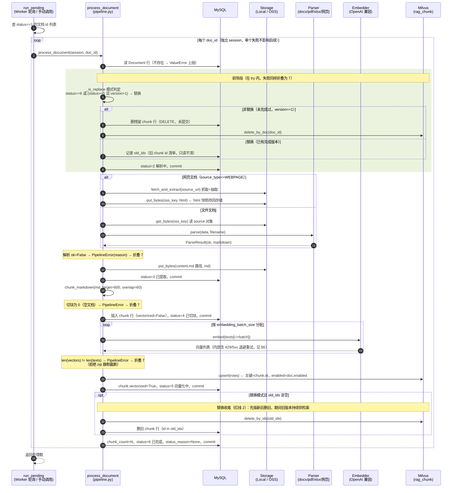
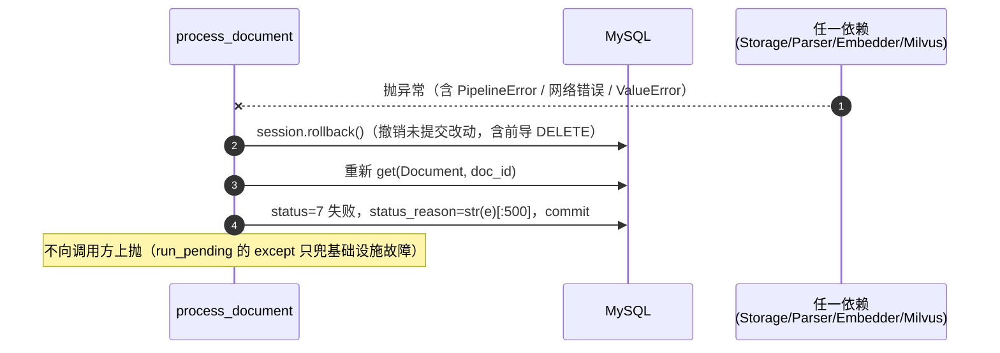
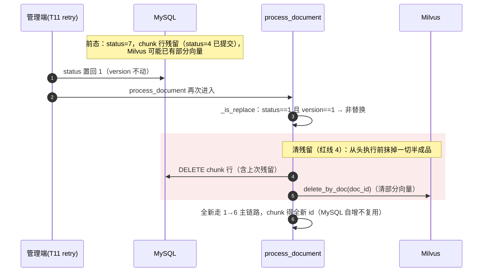
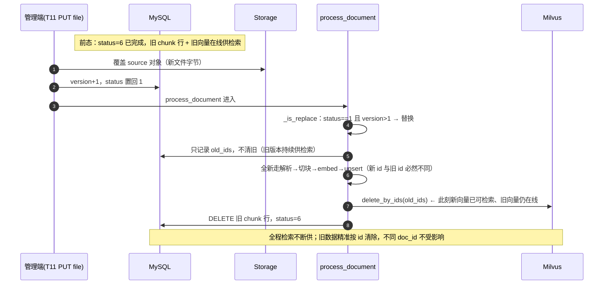
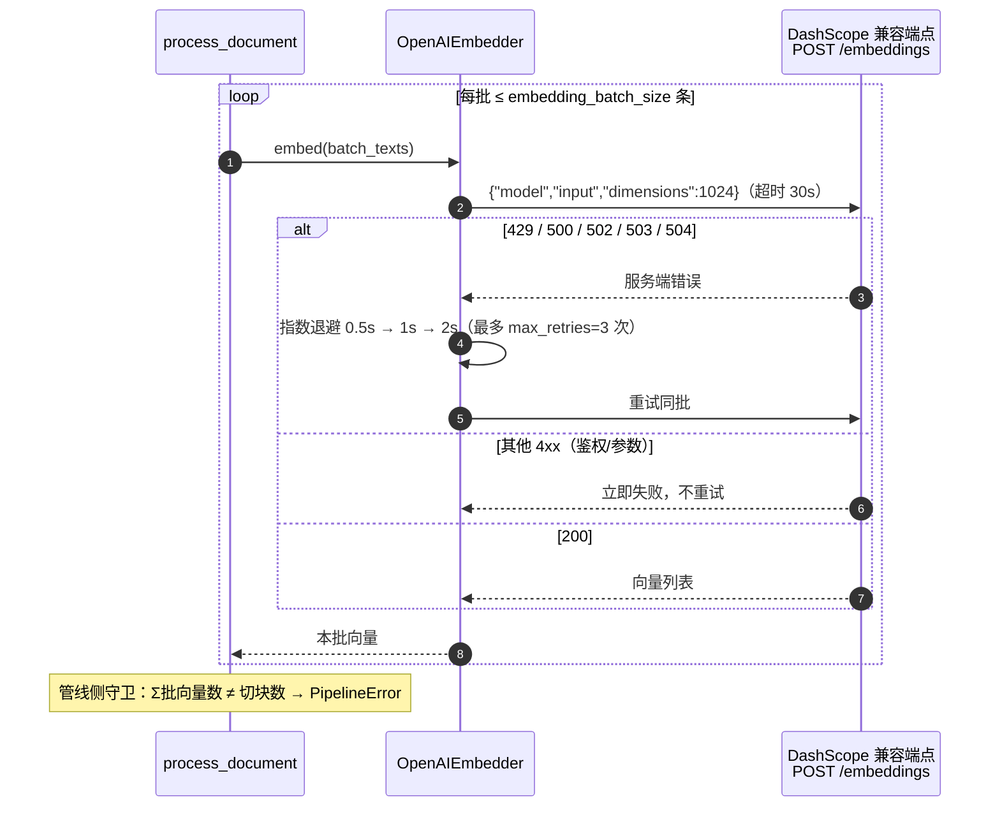

# EverKB 后端链路时序说明

> 对应代码：`backend/app/services/pipeline.py`（commit `e3a3cbb`，Task 10 审查修复轮之后）。
> 面向读者：接手 Task 11/12（文档 API、md 编辑）的实现者，以及排查摄入问题的运维。
> 图为 Mermaid sequenceDiagram，GitHub / PyCharm（装 Mermaid 插件）可直接渲染。

---

## 1. 链路总览

一条文档从上传到可检索，依次经过：**存储 → 解析 → 切块 → 向量化 → 入 Milvus**，
全程由 `process_document` 单函数驱动的状态机管理（MySQL `document.status` 1→6），
任何一步失败折叠为 7 并写失败原因。

```
                     ┌─────────────── 摄入管线（process_document）────────────────┐
                     │                                                            │
 HTTP 上传(T11) ──►  │ [模式判定] ─► 取内容 ─► parser.parse ─► content.md 落存储   │
 Worker 轮询(T11) ─► │    │             (文件/网页)      │              │         │
                     │    │ 清残留                       │              ▼         │
                     │    │ (非替换时)                   │         chunk_markdown │
                     │    ▼                             │              │         │
                     │ MySQL chunk 行 + Milvus by_doc   │              ▼         │
                     │                                  │      chunk 行入 MySQL  │
                     │                                  │              │         │
                     │                          Embedder(DashScope) ◄── 分批     │
                     │                                  │              │         │
                     │                Milvus.upsert ◄───┴──── 向量数守卫          │
                     │                                  │              │         │
                     │              [替换收尾: 按 old_ids 精准清旧] ◄─ 替换模式   │
                     └────────────── status=6 提交 ─────┴────────────────────────┘
```

组件约定（Plan 1 Global Constraints）：

| 组件 | 实现要点 |
|---|---|
| 存储 | `kb/{kb_id}/doc/{doc_id}/source.{ext}` + 同目录 `content.md`；Local/OSS 可插拔 |
| 解析器 | docx/pdf/xlsx/网页 → Markdown；任何异常折叠为 `ok=False` + 中文 reason，绝不上抛 |
| 切块 | 600 字符/块、重叠 60；表格行原子不拆、PDF 页标记 `<!-- page:N -->` 提取为 page_number |
| Embedding | OpenAI 兼容协议（DashScope text-embedding-v4，dim=1024），批量 ≤ `embedding_batch_size` |
| Milvus | collection `rag_chunk`；HNSW COSINE；`kb_id` partition key；**主键 = MySQL chunk.id（auto_id=False，upsert 写入）** |
| MySQL | `chunk.id` 兼作 Milvus 主键；无物理外键；替换窗口允许新旧并存（§6.2 决策） |

---

## 2. 主链路时序（status 1 → 6）



要点：

- **前导段在 try 内**（审查修复轮 I-1）：`delete_by_doc` 遇 Milvus 宕机不再逸出——
  否则文档永远卡在 status=1，且未提交的 chunk 批量 DELETE 会滞留在调用方事务里。
- **MySQL 事务边界**：每个状态推进点一次 commit；status=4 提交后 chunk 行已持久化，
  后续 embed/Milvus 失败留下「chunk 行存在、向量未入」的中间态，由重试清理（§4）。
- **先插新后删旧**：替换收尾发生在新向量 upsert 之后，「替换期间不断供」由
  `test_replace_old_vectors_served_until_new_inserted` spy 钉死。

---

## 3. 失败折叠时序（status → 7）



响亮失败的三类业务失败（都是 `PipelineError`，reason 写入 `status_reason`）：

| 触发点 | 条件 | reason 示例 |
|---|---|---|
| 解析后 | `ParseResult.ok=False` | 「docx 解析失败：…」「疑似扫描件：未提取到文本层…」 |
| 切块后 | `drafts` 为空 | 「文档内容为空：解析成功但无可切块内容」 |
| embed 后 | 向量数 ≠ 切块数 | 「向量化返回数与切块数不符：9 != 10」 |

---

## 4. 重试时序（7 → 1，红线 4 清残留）



---

## 5. 替换时序（version>1 或 status==6 进入，红线 2 不断供）



**`_is_replace` 判定表**（retry 不动 version 的语义）：

| 进入时 status | version | 判定 | 行为 |
|---|---|---|---|
| 1（首次上传） | 1 | 非替换 | 清残留（红线 4） |
| 1（retry，7→1） | 1 | 非替换 | 清残留——version==1 的失败 retry 走这里 |
| 1（替换后 retry） | >1 | 替换 | **仍走替换分支**：旧完成版保供检索，成功后按 ids 清旧 |
| 6（对完成态重跑） | 任意 | 替换 | 计划原文路径 |

---

## 6. Embedder 内部时序（批次与重试）



## 7. Milvus 写入与一致性要点

- **upsert 而非 insert**：主键 = MySQL `chunk.id`（auto_id=False）。同 id 重插必须覆盖，
  plain insert 会产生双实体共搜（Task 9 修复，commit `d48061e`）。
- **一致性 Strong**：pymilvus 默认 Bounded 有数秒读不可见窗口，会踩空「写后立读」
  （`set_doc_enabled` 的 query 取回、清库后的 count 校验）。一期单体直接用 Strong 换正确性。
- **partition key**：`kb_id` 自动分区裁剪；检索 filter 恒带 `enabled == True`。
- **停启用**：`set_doc_enabled` = query 取回含 vector 整行 → 翻 enabled → upsert 回写。

---

## 8. 文档状态枚举

| 值 | 常量 | 含义 | 提交时机 |
|---|---|---|---|
| 1 | UPLOADED | 已上传待处理 | 上传/T11 retry 置回 |
| 2 | PARSING | 解析中 | 前导段完成后 |
| 3 | EXTRACTED | 已提取（content.md 已落存储） | content.md 写入后 |
| 4 | CHUNKED | 已切块（chunk 行已入库） | chunk 插行后 |
| 5 | VECTORIZING | 向量化中（向量已入 Milvus） | upsert + vectorized=True 后 |
| 6 | COMPLETED | 已完成（可检索） | 替换收尾 + chunk_count 提交 |
| 7 | FAILED | 失败（status_reason 存摘要 ≤500 字） | 异常折叠时 |

---

## 9. 红线约束 ↔ 测试对照

| # | 红线 | 钉子的测试 |
|---|---|---|
| 1 | 扫描件 PDF 必须失败（7 + 含「扫描件」），不允许 0 chunk 却完成 | `test_scanned_pdf_fails` |
| 2 | 替换后旧向量精准清除；替换期间旧版本不断供 | `test_replace_clears_old_chunk_ids` + `test_replace_old_vectors_served_until_new_inserted`（spy 顺序钉） |
| 3 | 删除文档 Milvus 先行 | Task 11 `test_delete_document_removes_vectors_first`（待实现） |
| 4 | 非完成态重试先清残留 | `test_retry_cleans_leftover_chunks` + `test_embedder_failure_retry_closes_loop`（真实失败注入闭环） |
| 5 | 切块不破坏结构（表格原子/页标记/连续 index） | `test_table_rows_not_split` 等（Task 7） |
| 6 | 超大单段句级硬切 ≤ target×2 且带重叠 | `test_long_paragraph_hard_split`（Task 7） |

另：前导失败折叠 `test_precleanup_failure_folds_to_7`；空文档响亮失败
`test_empty_document_fails_loudly`；向量数守卫 `test_embedder_count_mismatch_fails_loudly`。

---

## 10. 当前接线现状（诚实边界）

截至 commit `e3a3cbb`，链路**代码就绪、HTTP 入口未接**：

- `main.py` 中 `embedder` / `vector` 仍为 None 占位——Task 8/9 的真实实现
  （`OpenAIEmbedder` / `MilvusVectorClient`）尚未接进 app 工厂；
- Worker 线程未挂载（`worker_enabled` 分支为注释占位）；
- 无上传/替换/重试/删除 API（全部属 Task 11）；
- 测试路径全绿（87/87，Fake 双件套不触网）；真实组件验证脚本：
  `scripts/verify_oss.py` / `verify_embedding.py` / `verify_milvus.py`（手动执行）。

Task 11 落地后，本文 §2 主链路即成为线上实际路径；届时需同步把
`.env` 的 `storage_backend` 从 local 切到 oss（当前 main.py 也默认 LocalDiskStorage）。

